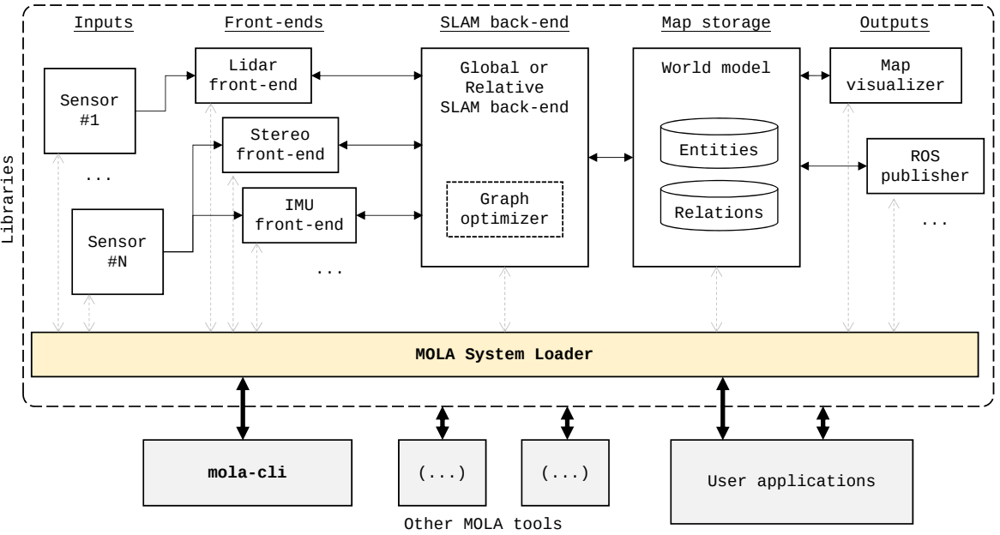

.. _concept_mola_architecture:
.. _concept_mola_arquitecture:

===================
MOLA architecture
===================

This page explains how a MOLA system is put together, for those who want to
compose their own systems or write new modules. How to write the system
configuration files is explained in :ref:`yaml_slam_cfg_file`.

.. contents::
   :depth: 1
   :local:
   :backlinks: none

|

Modules
---------

A MOLA system is a set of **modules**, each one an instance of a C++ class
implementing the ``mola::ExecutableBase`` interface. According to its role in
the system, a module also implements one or more of the virtual interfaces of
``mola_kernel``: a data source (``RawDataSourceBase``), a front end
(``FrontEndBase``), a state estimator (``NavStateFilter``), a map server
(``MapServer``), a visualizer (``VizInterface``), etc. These common interfaces
are what make modules reusable and interchangeable.

The system loader, :ref:`mola-cli <mola_cli>`, reads a
:ref:`system configuration file <yaml_slam_cfg_file>`, loads the required
libraries, creates the modules and runs their life cycle. Running modules find
each other by name or by the interface they implement, to exchange data and
signals directly.

|

.. _concepts_mola_paths:
.. _concepts_module_lib_dir:

How MOLA finds its modules
----------------------------

At start up, ``mola-cli`` loads every shared library whose file name contains ``mola``
(``*.so`` on Linux, ``*.dll`` on Windows) found in these directories, in this order:

1. The library output directory of the ``mola_launcher`` build (development builds).
2. The directories in the environment variable ``MOLA_MODULES_LIB_PATH``
   (``path1:path2:...``), for modules installed elsewhere.
3. The directories in ``LD_LIBRARY_PATH``. After sourcing a ROS 2 workspace
   (``source install/setup.bash``), it includes the ``lib`` directory of every installed
   package, so all MOLA modules are found with no further configuration.

Loading a library registers its classes, which can then be used as the ``type`` of a module
in a :ref:`system YAML file <yaml_slam_cfg_file>`. A library that cannot be loaded (e.g. a
missing dependency) is skipped with a warning.

To see the search paths and the modules found, and the classes they provide:

.. code-block:: bash

    mola-cli --list-modules
    mola-cli --rtti-list-all

To refer to a file installed by a ROS 2 package from a YAML file, use its share directory:
``$(ros2 pkg prefix <package>)/share/<package>/...`` (see :ref:`yaml_cmd`).

|

.. _concept_simulation_real_time:

Time: datasets and live sensors
---------------------------------

MOLA modules must work the same whether their inputs come from live sensors or
from a recorded dataset, including pausing it or changing the playback rate.
This makes it possible to debug front ends and back ends on recorded data, and
to run unit tests of complex SLAM systems on slow machines, e.g. build farms.

Hence, when writing a module:

- **Never** use the system clock for anything related to estimation, keyframe
  selection, etc.
- **Only** rely on the timestamps of the input observations. Every input is a
  class derived from ``mrpt::obs::CObservation``, whose ``timestamp`` field is
  the time at which the data was captured.
