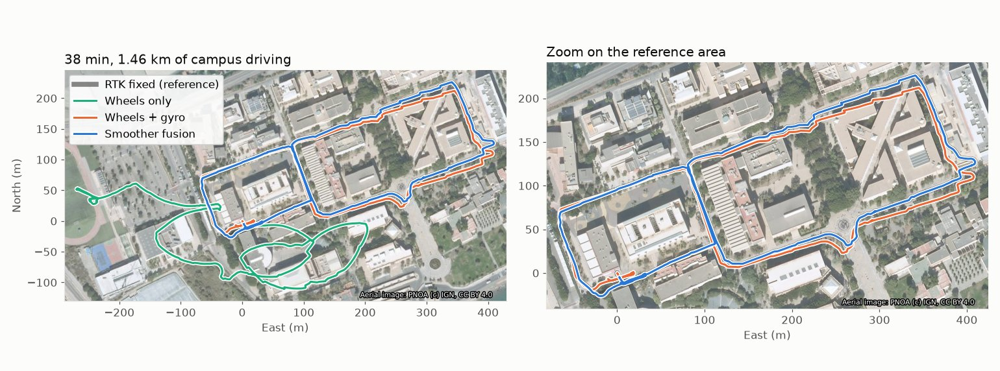
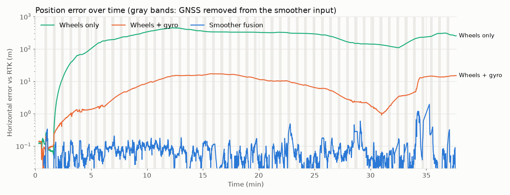
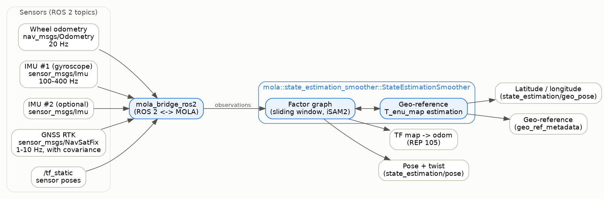
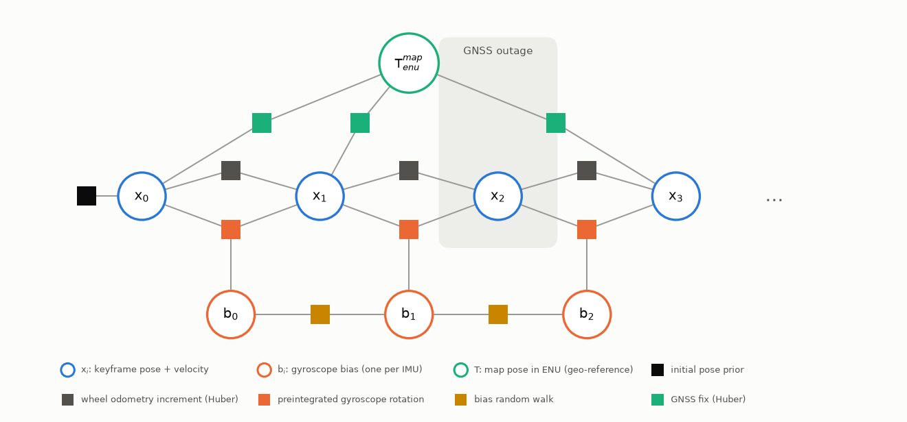
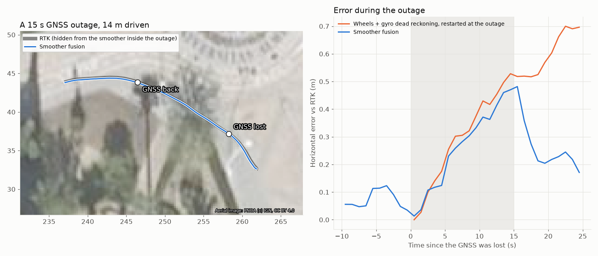
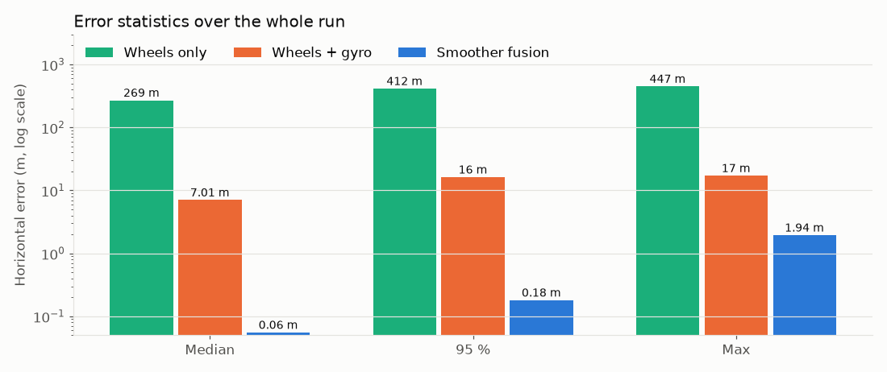
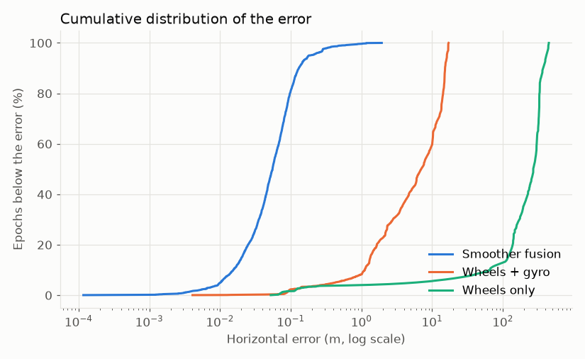

.. _tutorial-wheels-imu-gnss-fusion:

=========================================================================
Wheels + IMU + RTK GNSS: geo-referenced localization through GNSS outages
=========================================================================

This tutorial shows how to fuse **wheel odometry**, the **gyroscopes of one or two IMUs**
and an **RTK GNSS receiver** with the MOLA state estimation smoother, so a ground vehicle
keeps a **centimeter-level, geo-referenced pose all the time, even while the GNSS is lost**
for a while. No LiDAR or camera is needed.

We use a real 38 min, 1.46 km drive of a Clearpath Husky around a university campus, and
compare three ways of estimating the robot position against the RTK ground truth:

.. list-table::
   :header-rows: 1
   :widths: 40 20 20 20

   * - Method
     - Median error
     - 95 % error
     - Max error
   * - Wheel odometry only
     - 269 m
     - 412 m
     - 447 m
   * - Wheel odometry + gyroscope
     - 7.0 m
     - 16.2 m
     - 17.1 m
   * - **MOLA smoother: wheels + 2 IMUs + RTK, GNSS removed 1/3 of the time**
     - **0.055 m**
     - **0.18 m**
     - **1.9 m**

.. contents::
   :depth: 1
   :local:
   :backlinks: none

|

The tutorial is also available as a video:

.. raw:: html

    

      <iframe width="560" height="315" src="https://www.youtube.com/embed/nocyFJUd1Hc" title="YouTube video player" frameborder="0" allow="accelerometer; autoplay; clipboard-write; encrypted-media; gyroscope; picture-in-picture; web-share" referrerpolicy="strict-origin-when-cross-origin" allowfullscreen></iframe>
    

|

1. Why fuse these sensors?
--------------------------------

Each sensor alone fails in its own way:

- **Wheel odometry** measures how far the wheels turned. It is smooth and always available,
  but it integrates small errors forever: a heading error of 1 degree becomes a lateral
  error of 1.7 m after 100 m. On a skid-steering robot the heading from the wheels is
  especially poor, because the wheels slip on every turn. In this dataset the wheel-only
  estimate ends **hundreds of meters away** after 1.5 km.
- A **gyroscope** measures the rotation rate very precisely over short times. With it,
  the heading error grows much slower, but its small bias still makes the position drift
  (meters after a few minutes). It cannot tell where the robot is on Earth.
- An **RTK GNSS receiver** gives the position on Earth with ~2-3 cm accuracy, but only
  while it has a carrier-phase fix: buildings, trees or vibrations make it degrade to
  "float" (0.5-2 m errors) or lose the solution. It gives positions at 1-10 Hz, but no
  orientation while the robot stands still.

The smoother combines them: GNSS anchors the position and, while the robot moves, the
heading; the gyroscopes and the wheels bridge the gaps, and keep the trajectory smooth
between fixes. The result is better than any of them alone:

In the plot above, the GNSS was **removed from the smoother input 15 s of every 45 s**
(gray bands). The RTK fixes inside those bands were never seen by the estimator, so they
are independent ground truth. At minute 34 the robot itself lost encoder counts and
reported about half its real speed for 15 s: with GNSS, the estimator rides through it.

.. note::

   That event is also the physical limit of this sensor set. The gyroscopes tell the
   heading, but **only the wheels tell the speed**: if they fail while the GNSS is also
   lost, nothing can correct the distance traveled (in a test where an outage overlapped
   it, the error grew to 8 m in 20 s, and dropped back to 0.2 m with the first fixes).
   Robots that need to survive that case need a second speed source, such as LiDAR or
   visual odometry, which this smoother can fuse as one more odometry input.

|

2. The dataset
--------------------------------

This sequence is part of the `Husky UAL LiDAR-Inertial Dataset
<https://w3.ual.es/~jlblanco/datasets/husky-ual-lidar-inertial-dataset/>`_ (CC BY 4.0 license).
Download it (a 70 MB zip file) and the tutorial scripts:

.. code-block:: bash

    wget https://ingmec.ual.es/~jlblanco/downloads/dataset-husky-2026-11-16/husky_2026-11-16_campus_wheels_imu_gnss.zip
    unzip husky_2026-11-16_campus_wheels_imu_gnss.zip
    # The tutorial scripts:
    mkdir tutorial && cd tutorial
    for f in run_fusion.sh gnss_outage_relay.py evaluate.py; do
      wget https://ingmec.ual.es/~jlblanco/downloads/dataset-husky-2026-11-16/tutorial/$f
    done
    chmod +x *.sh *.py

It is a ROS 2 bag (MCAP) with these topics, all under the robot namespace ``/a200_0812``:

.. list-table::
   :header-rows: 1
   :widths: 30 25 10 35

   * - Topic
     - Type
     - Rate
     - Sensor
   * - ``platform/odom``
     - ``nav_msgs/Odometry``
     - 20 Hz
     - Wheel odometry (skid steering)
   * - ``taobotics/imu``
     - ``sensor_msgs/Imu``
     - 150 Hz
     - HandsFree 9-axis IMU, aligned with ``base_link``
   * - ``ouster/imu``
     - ``sensor_msgs/Imu``
     - 100 Hz
     - IMU inside the Ouster LiDAR (no LiDAR data included)
   * - ``gnss/f9p/weighted``
     - ``sensor_msgs/NavSatFix``
     - 1 Hz
     - u-blox ZED-F9P with RTK corrections (NTRIP)
   * - ``gnss/ublox``
     - ``sensor_msgs/NavSatFix``
     - 1 Hz
     - Low-cost u-blox 7 (meter level)
   * - ``tf_static``
     - ``tf2_msgs/TFMessage``
     -
     - Sensor poses, including the GNSS antenna (``base_link -> gps_f9p``)

Two details of the GNSS data matter for any robot, not only this one:

- **Realistic covariances.** Many receivers report ~1 cm sigmas both in RTK *fixed* and
  RTK *float*, while float solutions are often 0.5-2 m off. The smoother weights each fix
  by its covariance, so overconfident float fixes would pull the estimate away. The topic
  ``gnss/f9p/weighted`` floors the sigmas per carrier solution: 3 cm (fixed), 0.5 m (float),
  3 m (no carrier solution).
- **Time stamps at the fix epoch.** A fix stamped when it arrives over USB is ~0.1-0.4 s
  late: at 1 m/s that is up to 0.4 m of error along the track. Here the fixes are stamped
  with the receiver's own solution time.

|

3. How it works
--------------------------------

The estimator is a MOLA module, ``mola::state_estimation_smoother::StateEstimationSmoother``,
running inside ``mola-cli`` together with ``mola::BridgeROS2``, which subscribes to the ROS 2
sensor topics and publishes the results:

Inside, the smoother keeps a **factor graph** over a sliding time window (a few seconds),
solved incrementally with GTSAM's iSAM2. Its variables are the robot pose and velocity at
each keyframe (:math:`x_i`), the gyroscope biases (:math:`b_i`, one chain per IMU) and the
pose of the local ``map`` frame in East-North-Up coordinates (:math:`T^{map}_{enu}`, the
**geo-reference**). Each sensor reading adds a factor (a soft constraint) between them:

- **Wheel odometry** adds the relative motion between consecutive keyframes. Its
  uncertainty follows the classic odometry motion model: proportional to the distance
  traveled (``a1``, ``a3``) and to the rotation (``a2``, ``a4``). A Huber robust kernel
  limits the damage of slips and lost encoder counts.
- **Gyroscopes** are *preintegrated* between keyframes into a relative rotation, with
  a slowly varying bias per IMU that the smoother estimates online. Only the gyroscopes
  are used (``gyro_only``): on a vibrating ground robot the accelerometers carry more
  noise than motion information, and the wheels already give the speed. Two IMUs mean two
  independent rotation measurements: their noise averages out.
- **GNSS** fixes are attached to the keyframe at their time stamp, through the antenna
  position on the robot (read from ``/tf``) and the geo-reference :math:`T^{map}_{enu}`.
  A Huber kernel downweights fixes that disagree with everything else (multipath).

**Geo-reference.** With ``estimate_geo_reference:=True`` the smoother estimates
:math:`T^{map}_{enu}` from the first meters of GNSS track. Once its uncertainty falls below
a threshold (``georef_convergence_in_enu`` judges it in ENU, around the robot), it is
published (``/tf`` ``enu -> map``, and as ``mola_msgs/GeoReferenceMetadata``) and,
with ``georef_track_after_convergence``, it keeps being refined while the robot drives.
From then on, the robot pose is available as latitude/longitude too.

**During a GNSS outage** nothing special happens: the graph simply has no GNSS factors for
those keyframes, so the wheels and the gyroscopes carry the pose forward from the last
fixes. Inside an outage the smoother cannot do better than dead reckoning with the same
sensors (in the plot below, both drift ~0.5 m in 15 s). What it adds is that it enters the
outage with the gyroscope biases and the heading already calibrated by the GNSS, so its
drift starts small, and that it pulls the estimate back as soon as the fixes return, while
pure dead reckoning keeps its error forever.

|

4. Running it
--------------------------------

Prerequisites: ROS 2 Jazzy (or newer) and MOLA, including ``mola_state_estimation``. See the
:ref:`installation instructions <installing>`.

.. code-block:: bash

    sudo apt install ros-$ROS_DISTRO-mola ros-$ROS_DISTRO-mola-state-estimation

Then run the script from the ``tutorial`` folder:

.. code-block:: bash

    cd tutorial
    ./run_fusion.sh ../results/fusion            # 38 min in real time
    RATE=4 ./run_fusion.sh ../results/fusion     # or 4x faster
    GUI=true RATE=4 ./run_fusion.sh ../results/fusion   # with the MOLA GUI

The script does four things, which is what you would do on your own robot:

**1. Configure the smoother** with environment variables. Every parameter of
``state-estimation-smoother.yaml`` can be overridden like this:

.. code-block:: bash

    # Wheel odometry noise model, and robust (Huber) kernels for odometry and GNSS:
    export MOLA_ODOM_MOTION_MODEL_A1=0.05      # [m/m]   distance error per meter
    export MOLA_ODOM_MOTION_MODEL_A4=0.10      # [rad/rad] heading error per radian turned
    export MOLA_ODOM_ROBUST_HUBER=3.0          # [sigmas]
    export MOLA_NAVSTATE_GNSS_HUBER=3.0        # [sigmas]
    # No accelerometers: tie the keyframe velocities to the poses, and start slow:
    export MOLA_NAVSTATE_SIGMA_INTEGRATOR_POS=0.2
    export MOLA_INITIAL_TWIST_SIGMA_LIN=1.0
    export MOLA_INITIAL_TWIST_SIGMA_ANG=1.0
    # Gyroscope-only preintegration of up to two IMUs:
    export MOLA_SMOOTHER_IMU_PREINTEGRATION=true
    export MOLA_SMOOTHER_IMU_PREINTEGRATION_GYRO_ONLY=true
    export MOLA_SMOOTHER_IMU_PREINTEGRATION_MAX_IMUS=2
    # Do not use the IMU's own orientation (its yaw comes from an uncalibrated magnetometer):
    export MOLA_IMU_ATTITUDE_SIGMA=0
    # Geo-reference: judged in ENU, and refined while driving:
    export MOLA_SE_GEOREF_CONVERGENCE_IN_ENU=true
    export MOLA_SE_GEOREF_TRACK_AFTER_CONVERGENCE=true

**2. Launch the estimator**, with the generic launch file of the smoother package:

.. code-block:: bash

    ros2 launch mola_state_estimation_smoother ros2-state-estimator.launch.py \
      use_sim_time:=True \
      estimate_geo_reference:=True \
      odom1_topic:=/a200_0812/platform/odom odom1_label:=odom_wheels \
      odom1_as_robot_pose:=False \
      imu_topic_name:=/a200_0812/taobotics/imu \
      imu2_topic_name:=/a200_0812/ouster/imu \
      gnss_topic_name:=/gnss/input

``odom1_as_robot_pose:=False`` tells the ROS 2 bridge that this source is planar wheel
odometry, so the smoother uses the wheel motion model above (``a1``...``a4``, Huber kernel).
The default (``True``) is for 3D odometry sources such as LiDAR or visual odometry, fused as
SE(3) increments with a fixed, much tighter uncertainty: with wheel odometry it would trust
the wheels far too much.

**3. Feed the GNSS**, here through a small relay node that drops the fixes 15 s of every
45 s to simulate outages (``OUTAGES=0`` disables them):

.. code-block:: bash

    python3 gnss_outage_relay.py /a200_0812/gnss/f9p/weighted /gnss/input --period 45 --off 15

**4. Play the dataset**, with the static transforms moved out of the robot namespace so the
bridge finds the sensor poses:

.. code-block:: bash

    ros2 bag play husky_2026-11-16_campus_wheels_imu_gnss --clock 100 \
      --topics /a200_0812/platform/odom /a200_0812/taobotics/imu /a200_0812/ouster/imu \
               /a200_0812/gnss/f9p/weighted /a200_0812/tf_static \
      --remap /a200_0812/tf_static:=/tf_static

The estimator publishes, among others:

.. list-table::
   :header-rows: 1
   :widths: 40 60

   * - Output
     - Content
   * - ``/tf`` ``map -> odom``
     - The localization correction, following REP 105
   * - ``/tf`` ``enu -> map``
     - The geo-reference, once converged
   * - ``/state_estimation/pose``
     - Fused pose and velocity (``nav_msgs/Odometry``) in ``map``
   * - ``/state_estimation/geo_pose``
     - Fused pose as latitude, longitude, altitude and ENU orientation
   * - ``/state_estimator/geo_ref_metadata``
     - The geo-reference (``mola_msgs/GeoReferenceMetadata``)

Open Foxglove or RViz on those topics to watch it live.

|

5. Evaluating the result
--------------------------------

``evaluate.py`` compares the run against the RTK fixed epochs of the dataset (those with
3 cm sigma), and computes the dead-reckoning alternatives from the same bag (wheel speed
integrated with the wheel heading, or with the gyroscope heading), aligned to the RTK
track over the first minute, as if the initial pose were perfectly known:

.. code-block:: bash

    python3 evaluate.py ../results/fusion

It prints the median, 95 % and maximum horizontal errors, overall and inside the outages,
and writes ``error_vs_time.png`` and ``trajectories.png`` in the run folder.

|

6. Things to try
--------------------------------

The script options make it easy to see what each sensor contributes. These are the results
on this dataset (horizontal error against the RTK fixes, GNSS removed 15 s of every 45 s
unless stated otherwise):

.. list-table::
   :header-rows: 1
   :widths: 34 12 12 12 30

   * - Command
     - Median
     - 95 %
     - Max inside outages
     - Notes
   * - ``./run_fusion.sh`` (2 IMUs)
     - 0.055 m
     - 0.18 m
     - 0.60 m
     - The reference configuration of this tutorial.
   * - ``IMUS=1 ./run_fusion.sh``
     - 0.073 m
     - 0.21 m
     - 0.61 m
     - One gyroscope is almost as good: the second one mostly averages noise.
   * - ``OUTAGES=0 ./run_fusion.sh``
     - 0.043 m
     - 0.12 m
     - (no outages)
     - All the GNSS fixes; the remaining error is mostly the RTK float periods.
   * - ``IMUS=0 ./run_fusion.sh``
     - (none)
     - (none)
     - (none)
     - No gyroscope: the heading from the skid-steering wheels stays too uncertain
       (~12 deg, threshold 5 deg), so the geo-reference never converges and no
       latitude/longitude is published. The gyroscope is what makes the heading precise.

You can also try a low-cost receiver by editing ``GNSS_IN`` to ``/a200_0812/gnss/ublox``:
in our tests the error is then around 2 m, limited by the receiver's own slowly varying bias.

|

7. On your own robot
--------------------------------

- **Sensor poses in** ``/tf``: the IMUs (their orientation matters, their position does
  not) and the GNSS antenna (its position matters: 0.5 m of lever arm is 0.5 m of error
  when the robot turns around).
- **GNSS covariances that tell the truth**, and **stamps at the fix epoch** (see section 2).
  If your driver cannot do it, a small relay node like the one in ``gnss_outage_relay.py``
  can fix the covariances from the receiver status.
- **Wheel odometry noise**: start with ``a1`` 0.05 and ``a4`` 0.10 for a skid-steering
  platform, and lower them for a differential drive robot with good encoders.
- **TF tree**: the smoother publishes only ``map -> odom``; keep your robot's
  ``odom -> base_link`` (for example, from its own EKF) as it is.
- **Start in an open area** with RTK fixed and drive a few meters: the geo-reference
  needs some motion to observe the heading.

|

8. Troubleshooting
--------------------------------

- *No* ``enu -> map`` *transform*: the geo-reference has not converged yet. Check
  the GNSS input topic and drive a few meters in a straight line.
- *The pose jumps when the GNSS comes back*: the GNSS covariances are probably
  overconfident (float solutions reported as centimeter-level).
- *The estimate drifts while the robot is still*: check that the IMU topics arrive
  (``ros2 topic hz``) and that the IMU frames exist in ``/tf``.
